  

<table align="center">
<tr>
<td width="62%" valign="top">

<h3>✦ about</h3>

I build things that live inside other things — games, chats and pipelines.

<ul>
<li><b>Game mods</b> — gameplay systems and UI for Minecraft and Project Zomboid</li>
<li><b>Bots</b> — Discord and Telegram bots, with admin panels to run them</li>
<li><b>Automation &amp; AI</b> — local LLMs, voice‑over and video pipelines, scripts that do the boring part</li>
</ul>
</td>
<td width="38%" align="center" valign="middle">
  
</td>
</tr>
</table>

<h3 align="center">✦ stack</h3>

  
  
  
  
  
   
  
  
  
  
  
  

  

